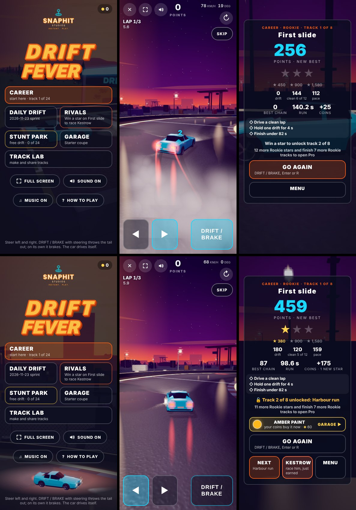

# Round 2: the first minute (`?first=2`)

Branch `crazygames-first-minute`, with main 2fc25d4 merged in. Brief:
`briefs/FIRST-MINUTE.md`. Everything is behind `?first=2`; without it
the game is main's, measured to the bit and to the pixel (measures 6
and 7). Probes are in `game/test/first/`, numbers in `review/first/`.
(Saved by the reviewer: the round's session could not write report
files.)

## What the clunk was

These are main's numbers: a newcomer's first run of track 1 from an
empty save, as a phone (390x844, touch, Easy). Ten scripted strangers
press late and press too long or too short. They hold a button into a
wall and press DRIFT / BRAKE when unsure. Figures are median (worst).

- **A held button is a speed limit.** Full steer asks for an 11 m
  circle at any speed and cuts the drive. Held, the car settles at
  12.9 m/s (46 km/h). Strangers hold a button 95 per cent of the run,
  so they average 13.1 m/s and take **132 s** (141) for three laps.
- **Taps barely turn the car.** A 50 ms tap turns 0.9 degrees and
  100 ms turns 3.4. 200 ms turns 9 to 11.
- **Walls stop the car dead.** There are 3 contacts a lap (1.7 hard),
  nose first, from 13 to 15 m/s to 0. With no reverse on Easy the car
  sits 1.2 s and is put back on the road: **3 put-backs a run (7)**,
  each a **camera cut: 7 a run (23)**. Spins: 4 (10), every one from a
  wall.
- **Hitches.** On WebGL 2, the first tail-light trail (2.6 s) and the
  first exhaust flame (3.2 s) build their materials mid run. In
  software those frames took 10.5 s and 4.2 s. On WebGPU, 8 pipelines
  are built after GO.
- **Stars.** 1 stranger in 10 earned one (first star 450).
- **Prompts** stood over the road 14 s (22). The slide prompt came on
  the first straight at 28 m/s.
- **Not the clunk: the slide and track 1.** Slides start from the press
  (100 per cent) and end at 64 degrees a second, with no snap. Scripted
  drivers lap track 1 clean on main (12 of 12 sectors). The walls came
  from the car, not the track, so **track 1 is unchanged**.
- **Keys (Pro a, 1280x720) are clunky too:** 18.7 contacts a lap, 7
  put-backs, 24 camera cuts, no stars.

## What changed, behind ?first=2

1. **The starter on Easy** (`FIRST` in `tune.js`, `physics/profile.js`):
   - **Held button.** It now asks for nine tenths of the front's grip,
     so it settles at 18.4 m/s on a 22 m circle, tighter than every
     corner of track 1. It no longer cuts the drive under 15 m/s.
   - **Taps are gentler.** 100 ms turns 2.2 to 3.4 degrees; 200 ms
     turns 5.4 to 6.9.
   - **A long hold bleeds speed.** A steer held 0.3 s bleeds to 19 m/s,
     so a held button makes the corner. A skilled thumb's pulses never
     trigger it.
   - **A kind wall.** The car keeps three quarters of its speed along
     the wall, and the nose turns along it in about a third of a second.
   - **Slides go the thumb's way and run wider.** DRIFT with steering
     kicks the tail the thumb's way, and slides carve a wider circle, so
     they no longer dive into the inside wall.
   - **Ghosts kept apart.** The new handling has its own ghosts
     (`first:` keys, revision 2).
2. **Prompts.** The slide prompt waits until the first corner is behind
   the car. The brake prompt comes 40 m before a corner taken at
   76 km/h or more.
3. **A star in the first run.** Track 1's first star is 380 (was 450).
   Two and three stars are unchanged.
4. **A way to the garage.** The results show what the coins already
   buy, with its colour and price (the cover's amber paint on a first
   run). One press opens the garage with it on the car and BUY as the
   button.
5. **No mid-run builds.** Each effect pool is built on the title, one
   per frame, then hidden. In a run all pools stay shown, empty, so
   anything a new ground changes is built at the countdown.
6. **A live title.** The starter drifts track 1 behind the menu, driven
   by the slide player with a player's hands.
   - It is filmed in the title's largest clear stretch. On a phone that
     is the band under the round buttons, side on; on a desktop, a
     corner, from the front three quarters.
   - The title's shade is opened round the car by a mask and is
     unchanged everywhere else. The menu is unchanged.
   - If a third of 60 title frames are slow, or the quality has stepped
     down, the car goes back to the line and stands for the visit.
   - Where there is no clear stretch, the title is main's.

## Before and after

Touch, 10 strangers, median (worst). Main, then `?first=2`:

| | main | ?first=2 |
|---|---|---|
| three laps | 132 s (141) | 92 s (99) |
| mean speed | 13.1 m/s | 18.2 m/s |
| score | 366 | 454 |
| strangers with a star | 1 of 10 | 9 of 10 |
| wall contacts a lap | 3 (3.7) | 2 (4.7) |
| hard hits a lap | 1.7 (2.3) | 1.7 (2.7) |
| scraping | 3.3 s (8.1) | 0.9 s (2.2) |
| crawling | 4.7 s (9.1) | 2.7 s (5.5) |
| put back on the road | 3 (7) | 0 (1) |
| camera cuts | 7 (23) | 0 (3) |
| spins | 4 (10) | 2 (6) |
| slides (into walls) | 7 (4) | 6 (3) |
| mean slide length | 0.9 s | 1.1 s |
| nose swung by a wall | 42°/s | 236°/s (the kind wall's turn) |
| prompts on screen | 14 s (22) | 14 s (22) |

Keys are unchanged (Pro keeps main's starter). Only the star count
moves, 0 to 1 of 10.

## Measures

| # | Result | Known answer |
|---|---|---|
| 1 Clunk | the table above; PASS | main with half steering reads worse: score 366 to 307, 132 to 145 s, 3 to 5.3 contacts a lap: caught |
| 2 Hitches, cold first run, first 30 s | WebGL 2: 0 pipelines built after GO (main 4), 2 frames over 3x the median (main 4), worst 420 ms (main 10.5 s). WebGPU: 0 after GO (main 8). PASS | a new material 15 s in: an 8.5 s frame with its build: caught |
| 3 Star in the first run | 9 of 10 strangers; careful driver 1 star, clean; PASS | main's targets on the same runs: 5 of 10, missing the bar |
| 4 Garage within 3 minutes | 108.8 s, amber paint on show, PAINT IT live; PASS | main's path 150.8 s with nothing on show; the line removed fails: caught |
| 5 Live title, pictures | WebGL 2 at both tiers and sizes, WebGPU at both tiers on a phone. Backdrop moves every sample; car in frame and under no button in all 600 frames of each page; lowest button contrast 5.28 to 5.48 (main 5.54 to 5.71, bar 4.5). PASS | its clear place put on the menu: under a button in 600 of 600 frames; frames drawn still: 60 of 60 still. Both caught |
| 5 Live title, cost, low tier, phone | draw calls 75 (main 81). Work 3.3 ms against 2.4 (WebGL 2) and 3.1 against 2.6 (WebGPU). **FAIL** (x1.38, x1.19; bar x1.10). Physics and driver are 0.1 ms of it | (method as look/cost.js) |
| 6 Rivals and replays | park/same.js and controls/easy.js all pass. All six rivals' own points and hashes are identical on main, the branch and the branch with the switch. PASS | ACCEL, DRIFT_HOLD and Kestrow's ENTRY each moved 1%: caught |
| 7 Nothing else changed | look/switch.js: 0 pixels differ (with ?look=1 and as shipped). start/check, play15, controls/words, ready/sizes, bench/check pass. start/boot passes all but its phone press check (see deviations) | each probe's own: caught |
| Rule 2, ghosts and saves | the new handling's ghost replays to the bit; old ghosts are kept and not raced; save keys kept. PASS | revision put back: not raced, caught |
| Rule 4, instant | initial download 2.72 MB (main 2.69). First 3D frame 6.2 s against 6.24 (WebGL 2), 2.6 s against 4.3 (WebGPU). Nothing new fetched except two code files. PASS | a page 2 s slower: caught; an extra request: caught |

## His Pixel 9 must confirm

- **Live title.** On the title, the car drifts in the band under the
  round buttons, with smoke and tail-light trails, and never sits under
  a button. The buttons still read.
- **Battery saver.** If the title car stands still on the line, the
  frames were slow. Say whether battery saver was on.
- **No stutters.** None in the title's first second, and none at the
  first slide or exhaust flame of the first run.
- **Effects still draw.** Smoke, sparks, flames and trails still show
  in a run. They are now kept as empty particle meshes.
- **Held button.** It takes a corner at about 68 km/h; a tap is a small
  correction.
- **Kind wall.** Does the nose's turn along the wall look natural, or
  like a snap?
- **Slides.** They go the thumb's way and run wider.
- **The flow.** Prompts come where they help. A star comes at 380, and
  the results' GARAGE line opens on amber paint.

## Cut, and why

- **Building effects in the background (compileAsync).** It built for a
  different picture than the one drawn, so everything was built twice.
- **Keeping the empty pools shown on the title.** It cost 0.7 ms of a
  3 ms frame.
- **The new handling under Pro.** The kind wall plus Pro's throttle let
  a car ride the walls.
- **Turning the nose along the wall at twice the rate.** It swung at
  200 degrees a second.
- **A mid-lap start for the title car.** Not needed: the first slide
  comes at about 4 s.
- **The adaptive quality's step down** still costs one long frame (9 s
  in software), as on main. Not changed.

## Deviations from the brief

- **"The same inputs on both."** The strangers react to their car, so
  both sides get the same seeded strangers, not the same presses.
- **Measure 2's 50 ms bar cannot be read here.** On WebGL 2 in software
  every frame takes over 100 ms. On WebGPU a pipeline is compiled
  outside the page, so its cost does not show in the page's frame time.
  Judged by pipelines built after GO and by spikes over 3x the run's
  median; frames over 50 ms are reported.
- **Measure 5's cost fails the bar**, as above. Main's title also
  stands on the day's daily track; the live title is on track 1.
- **Rule 4.** Two new code files are fetched before the first tap:
  `src/first.js` and `src/camera/title.js`, about 7 KB. They are
  counted in the initial download.
- **Track 1 is unchanged**, so Kestrow is untouched.
- **The new handling is on Easy only.** Keys are unchanged and still
  clunky.
- **The scripted drifter** (steering like a stick) no longer slides on
  the new handling: 1 point from slides against 383 on main. This
  affects a gamepad set to Easy. Touch and keys are all or nothing and
  are not affected; a gamepad defaults to Pro, which keeps main's
  handling. Open.
- **Rivals' lead bonus moves with the player's car.** It is won against
  the player, so with the new starter the scripted mixed player gives
  Tolvo, Varsk and Halvik more of it: 5,869 to 6,481, 7,018 to 8,034
  and 3,509 to 4,681.
- **The title's shade is opened round the car.** The menu and
  everything else keep it as before.
- **start/boot.js phone press check is flaky in the sandbox.** It
  presses start here before the game is ready, in a window of about
  20 ms. It failed 3 of 3 runs on this branch and 1 of 3 on main
  itself. The branch changes no boot code without the switch. (The
  reviewer's run on the merged tree passed it.)

## Play guide

1. Open **driftfever.com/?first=2** in a private tab (an empty save).
   Watch the title for ten seconds, press CAREER start here, play the
   first run, and look at the results.
2. Do the same in a new private tab **without the switch**.
3. The question: **is the first minute better, and is anything still
   clunky?**
