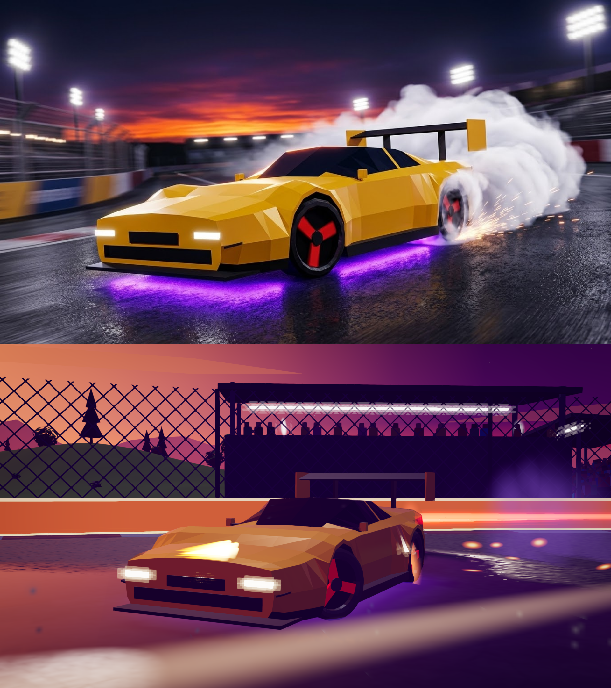
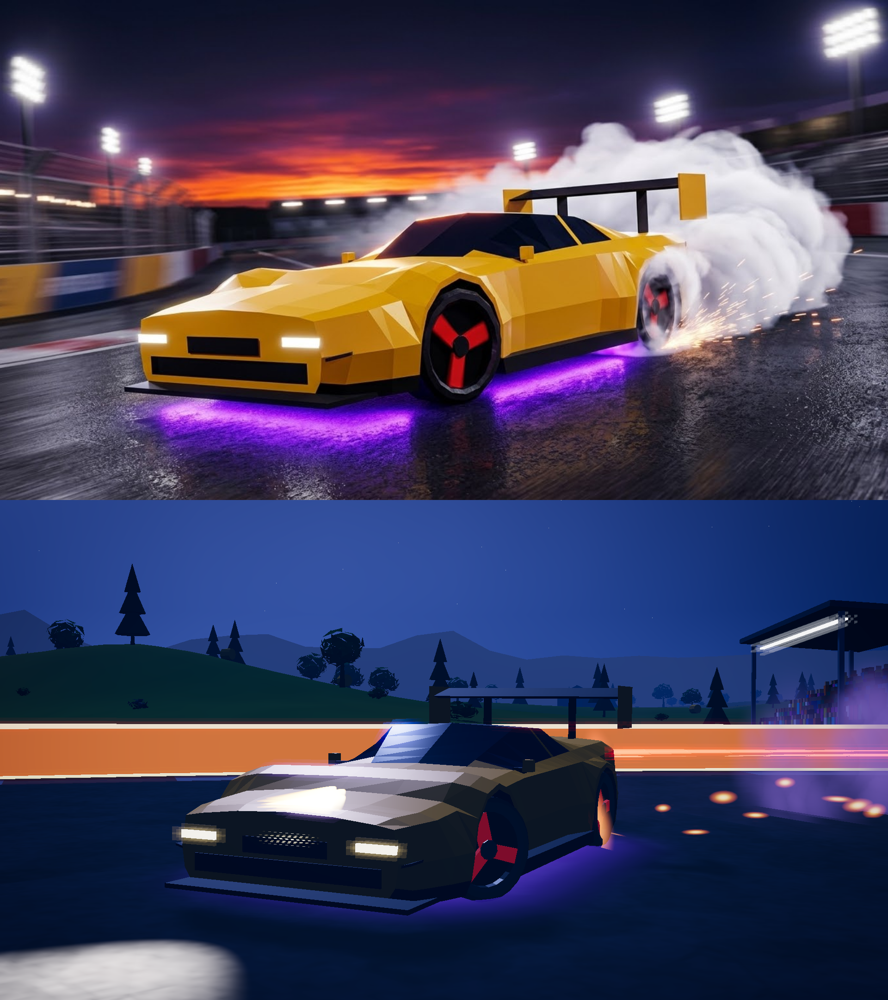
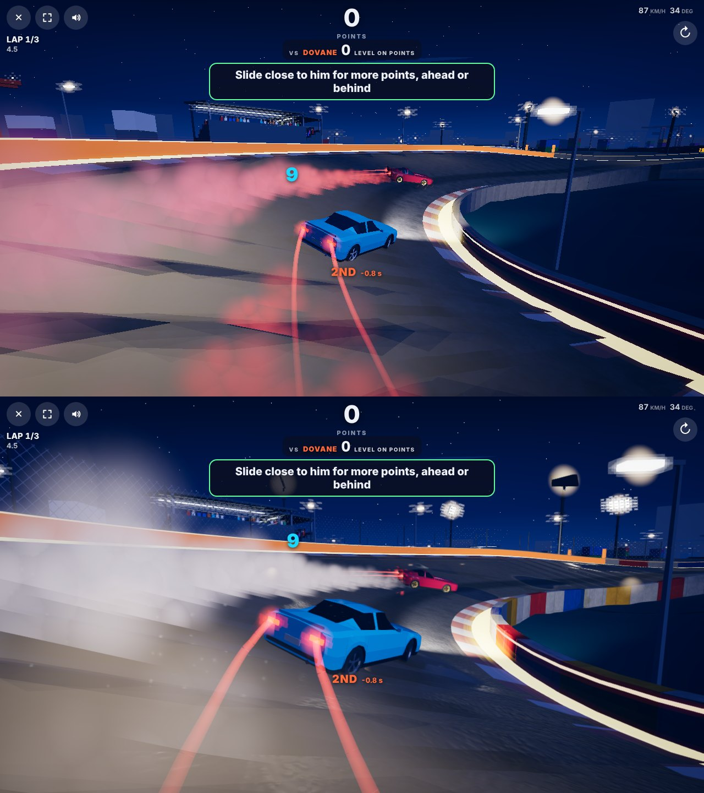
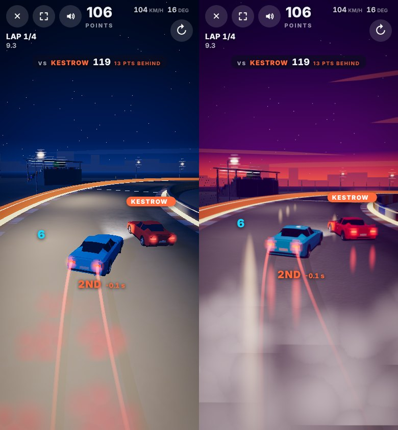

# Round 1A: the game drawn like its cover (`?look=2`)

Branch `crazygames-look`, with main 4d7c372 merged in. Brief:
`briefs/COVER-LOOK.md`. Everything is behind `?look=2`. Without it every
frame is main's, pixel for pixel (measure 8, rerun by the reviewer
before the merge).

## The cover pair

The cover art over the game's own frame, from the cover's camera:
Varsk's race on Upper deck at step 651, the drift build in amber on
tri-blades with the violet glow, `?look=2` at the look's floodlit dusk,
high tier.

Before the round (main, night):

It is much nearer the cover than before, but not there yet. Three
things are missing at that moment: billowing smoke, floodlight heads in
the shot, and the paint's gloss (measure 1).

## A race, before and after

Before on top and `?look=2` below (side by side in portrait). The
starter in cyan, the HUD in, the same step of the same race, high tier.

| | 1280x720 | 390x844 |
|---|---|---|
| Day (dawn), Sarrow, Endless eight | [pair](pairs/day-1280x720.jpg) | [pair](pairs/day-390x844.jpg) |
| Dusk, Varsk, Upper deck | [pair](pairs/dusk-1280x720.jpg) | [pair](pairs/dusk-390x844.jpg) |
| Night, Dovane, Over and under | [pair](pairs/night-1280x720.jpg) | [pair](pairs/night-390x844.jpg) |
| Career 1 at floodlit dusk, Kestrow | [pair](pairs/first-1280x720.jpg) | [pair](pairs/first-390x844.jpg) |

## Measures

| # | Measure | Result | Known answer |
|---|---|---|---|
| 1 | Bonnet's brightness spread with the environment at least x2 | **Fails.** Race x0.83 at floodlit dusk, x0.99 at dusk. Showroom x1.31 | Environment off on both sides: x1.00, caught |
| 2 | Cover pair | Above, for the author's eye | None |
| 3 | Car's share of the width, median of 600 frames, 14 to 18% in landscape | 15.8% at 1280x720 and at 844x390. Portrait 24.7% (main 25.3) | Main's camera: 9.5% and 7.8%, fails |
| 4 | Road ahead, 24 career tracks x 5 themes | 0.26% of 165,000 sight lines blocked, none within 30 m, worst track 1.48% (main 0.03%) | Barrier across the line: 13 blocked, 6 within 30 m |
| 5 | Stair steps on a kerb edge, low tier, 1280x720 | Main 227 of 227 rows stepped. Look 0 of 273 | `?aa=0`: 100% |
| 6 | Low tier within 10% of main, 3 races | Draw calls x1.01, triangles x1.01 to x1.03. Work: WebGPU x1.08, x1.03, x1.09 (pass). **WebGL 2 x1.19, x1.22, x1.43 (fails)** | 500 extra meshes: 600 calls and 7.5 ms against 99 and 3.2, caught |
| 7 | Every new thing read back, WebGL 2 and WebGPU, both tiers | 56 of 56 | Lamps hidden in both pictures: 0 pixels change, caught |
| 8 | Switch: identical without `?look=2` | 8 of 8 frames, 0 pixels differ (both tiers in dawn, dusk and night, plus title and showroom) | One pixel moved one level: caught |
| 9 | Nothing else changed | `park/same` 8/8, `play15` 13/13, `start` 27/27, `bench/check` 6/6, `ready/sizes` 12/12, `garage/readable` 60/60. With the look, readable 68 of 70 | Each probe's own |

## Cost per tier

- **Low tier:** draw calls +1, triangles +1 to +3%.
  - On WebGPU the game's own work per frame is within 10% on all three
    races.
  - On WebGL 2 it is 19 to 43% more (an earlier run gave 7 to 29%),
    measured with the GPU process and the page on separate cores, three
    browsers a side.
  - On the day race, about half of the extra is the environment
    (`?env=0`). The rest is spread across three.js submitting the
    look's materials object by object.
  - The post pass is not the cause: the canvas's own MSAA with no pass
    measured the same, and it was not kept.
- **High tier (WebGPU, reported):** draw calls +2, triangles +1 to +5%,
  work +17 to +21%.
- **GPU time is not measured here** (the sandbox draws in software).
  The bench on real devices is the real measure.

## Initial download

2.68 MB (main 2.59 MB, cap 4 MB). Textures and environments are made at
load, and nothing was added to `ASSETS.md`.

## For the author's Pixel 9 to confirm (WebGPU)

Open `?look=2` and compare it with `?look=2&env=0` and `?look=2&aa=0`:

1. **Cars:** they draw at all, with clear coat paint, dark glass, and
   trim using two new one-float vertex attributes (`rough`, `metal`).
2. **Reflections:** sky and lights show in the paint and the road (the
   environment is made at load).
3. **Road:** grain on the high tier, and wet patches at night and
   floodlit dusk.
4. **Floodlight towers:** lamp banks glowing, pools of light, streaks on
   the wet road.
5. **Catch fence:** a wire texture with alpha test, plus its posts and
   the panelled barriers.
6. **Flares and wet streaks:** these use the glow particles' four part
   `glow` attribute, which is not yet confirmed on the Pixel 9.
7. **Picture:** smooth edges, and nothing black, blank or upside down
   (the post pass: MSAA, bloom, grade and FXAA).
8. **Showroom:** the studio's strips show in the paint.
9. **Floodlit dusk:** career 1 and the title have the sunset band and
   the lights on. Under the title's dimming, the backdrop changes
   little.
10. **Smoke:** white and thick, darker near the road. In portrait it
    fills the bottom of the screen.

## Cut, and why

- **Gantries and banners over the track:** not built, for time, and a
  gantry over the road would need the occlusion probe to place it. The
  sponsor boards are multiplied instead.
- **Occlusion probe gaps:** it does not place the catch fence or the
  lamp row.
- **Showroom antialiasing:** none; it has its own render path.
- **Measure 1:**
  - The cars keep the flat sky fill under the environment
    (`LOOK.COVER.CAR_HEMI`). Without the fill the race passed (x2.47),
    but a car's shaded side was too dark to read its colour at dusk, so
    readability came first.
  - The brief's premise does not hold for these faceted cars. A bonnet
    without reflections is not one shade: its facets already spread
    0.22. The environment fills those shadows more than its faint mirror
    images add.
  - Not worked around; it is for the author's eye.
- **WebGL 2 low tier cost:** not fixed. The next step is to take the
  environment off the low tier, if the bench shows the cost.

## Deviations from the brief

1. FXAA is written in TSL and runs after the tone curve on both tiers.
   MSAA is on the high tier only, because MSAA alone left two thirds of
   a bright edge stepped.
2. The extra grandstands are on the high tier only. On the low tier the
   smoke keeps the show's life and size.
3. The low tier now has the colour grade, inside the FXAA pass. Main's
   low tier has none.
4. In portrait the car keeps a quarter of the width (24.7%). Shrinking
   it to 14 to 18% would make the car smaller on a phone.
5. One line changed in `main.js` (the title's backdrop). In
   `garage/showroom.js`: the studio, its lamps at 45%, and no sky fill
   there.
6. With the look the underglow runs at 70%; at full strength 14 of 50
   readability cases failed. `visuals/occlusion.js` and
   `garage/readable.js` gained `--look`, with results in `review/look/`.
7. The cost probe steps one frame at a time with the GPU idle, at
   320x180, on pinned cores, pooled over two or three browsers a side.
   Unpinned, the same build varied by up to 30%.
8. Measure 1's race is measured at floodlit dusk and at dusk. Measure 7
   sees the lamps from a camera facing a tower head: at 21 m up they are
   above the chase camera's view near the car.

## Learnt about this sandbox

- It has 2 cores. Timing probes are only stable with the GPU process and
  the page pinned to separate cores.
- A WebGPU page there sometimes never gets its device, so probes should
  retry.

## Please run

`?bench=1&adapt=0&look=2` and `?bench=1&adapt=0` on the desktop and on
the Pixel 9, both results from each.
