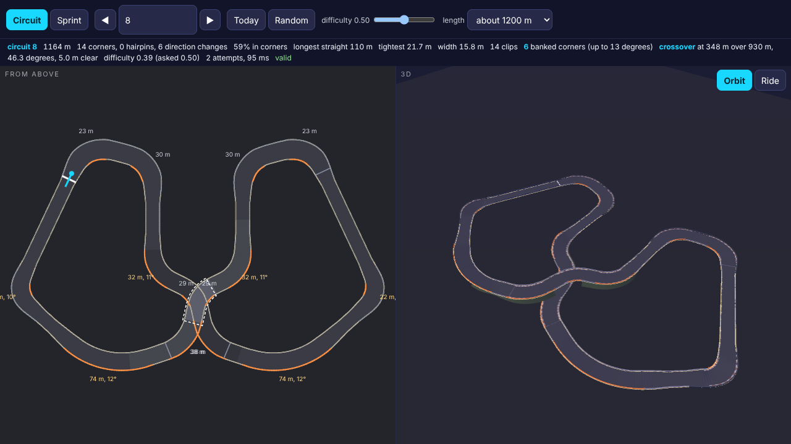
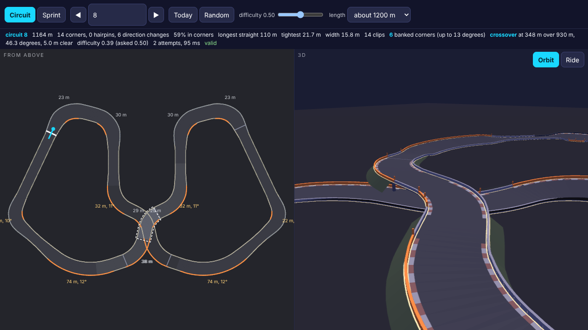
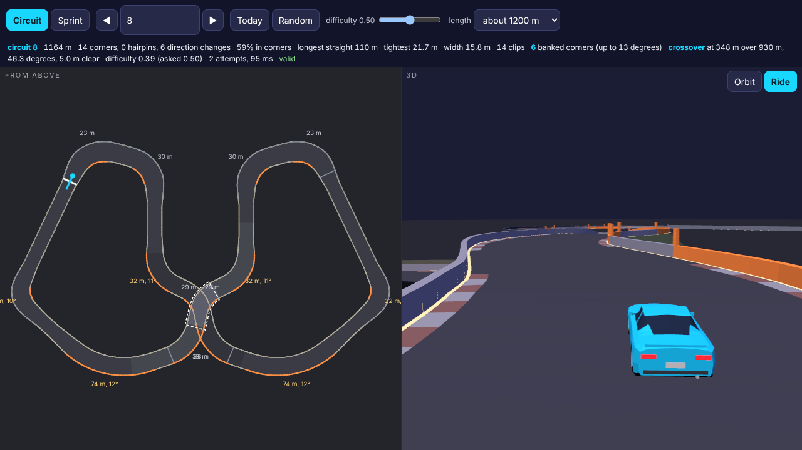
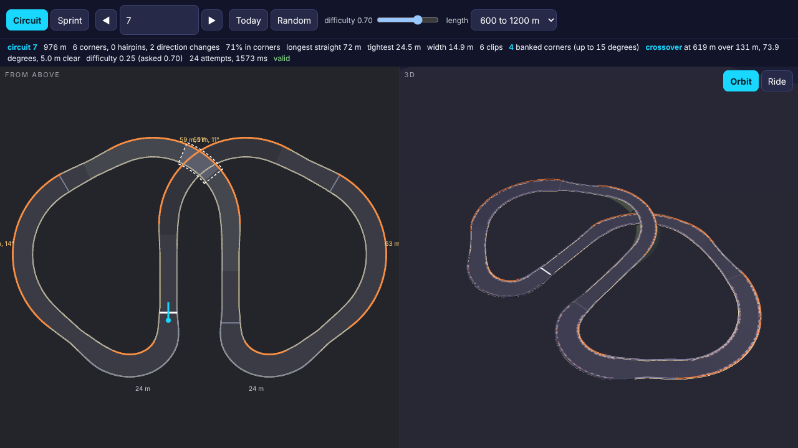
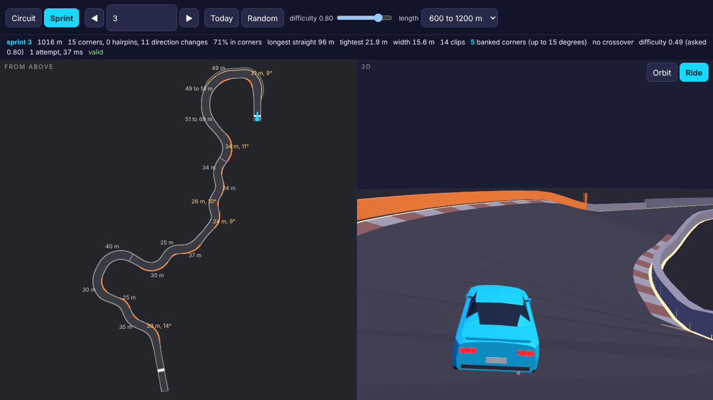
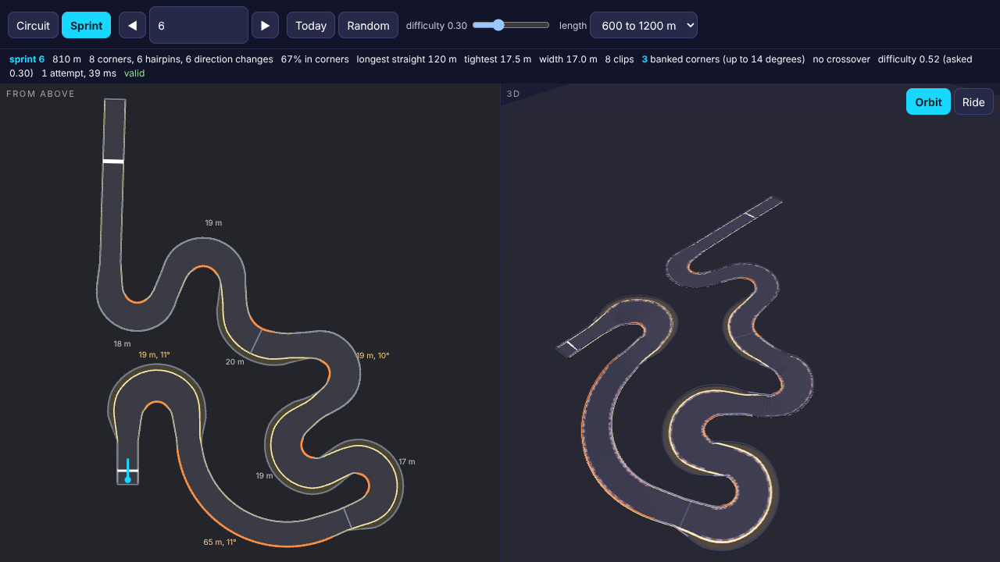
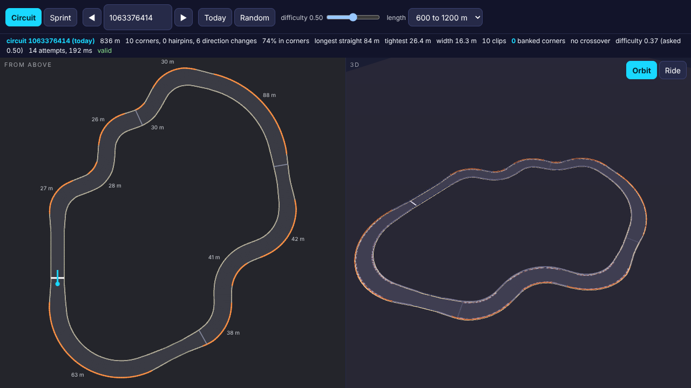
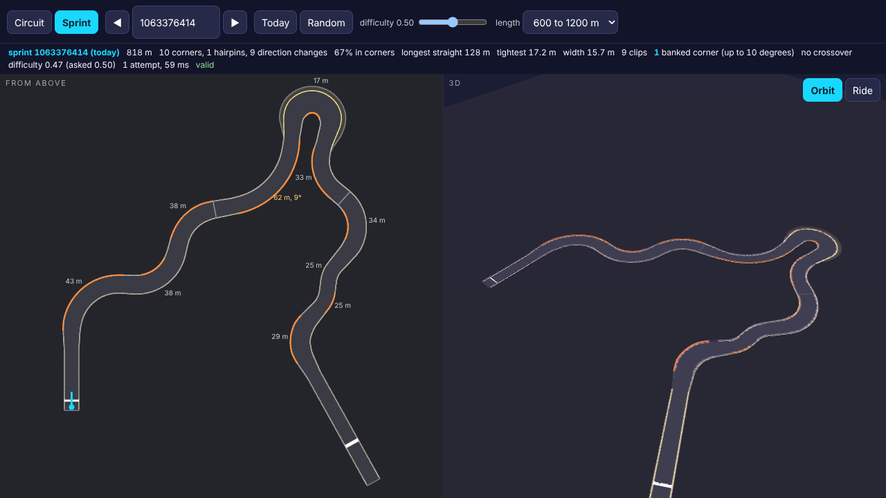

# More complex tracks: report

Branch `crazygames-tracks-2`, brief `briefs/TRACKS-2.md`. Every number
below was measured by `game/test/tracks/tracks2.js` (the brief's
measurements), `game/test/tracks/probes.js` (the first generator's
determinism, validity and drive probes, rerun on the new one at 1,000
seeds per kind) and the feel and loop probes, on this sandbox: two
cores shared with another session, Node for the generator and the
physics, headless Chromium on the forced WebGL 2 path for the pages.
The JSON and logs beside this file are what they wrote.

## In short, for a phone

- **Busier.** Five new corner features join the five: a flowing chain
  of three to five linked corners, a long multi apex corner whose
  radius changes at each apex, a double hairpin, a corner that tightens
  and one that opens. Straights between features are mostly short
  links (60 to 85 per cent of them, 4 to 18 m); a circuit keeps one
  longer run at the start to breathe and build speed (70 to 120 m, less
  on a short lap). Against the generator on `main`, 200 seeds per kind,
  medians before to after: corners per kilometre 10.7 to 12.1
  (circuits) and 11.3 to 12.6 (sprints), the share of the length in
  corners 62 to 70 per cent and 61 to 69, direction changes per
  kilometre 6.6 to 8.0 and 8.2 to 9.6, the mean straight 37 to 26 m and
  33 to 24, the second longest straight 80 to 64 m and 70 to 58, the
  longest 120 to 102 m and 114 to 100. Known answer: the old generator
  scores lower on every busyness median and higher on every straight
  median, both kinds.
- **Banked corners.** 23 per cent of circuit corners and 20 per cent of
  sprint corners are tilted towards their inside by 8 to 14 degrees,
  built over their clothoid in and out; sweepers and multi apex corners
  always get the offer, chicanes never. The physics feels it: the
  world reads the road's slope under the car each step and the vehicle
  gets gravity's share across and along the road, the load a bank
  presses it into the road with, and a crest's unloading. Round a 60 m
  corner the car's steady grip speed is 111 km/h flat and 134 km/h on
  a 9 degree bank (1.21 times; the bank angle predicts 1.21), 158 km/h
  on 13 degrees (1.43 times; predicted 1.35, within 6 per cent). A held
  drift settles at 86 km/h flat and 106 km/h on a 12 degree bank.
  Known answers: with `BANK.GRIP` at 0 the banked corner gives the flat
  speed to the metre; with `BANK.CRUISE_PER_DEG` at 0 the drift settles
  at the flat speed. On a flat road every new term is exactly zero: the
  Node handling probe and the two lap test track sim are byte identical
  to `main`.
- **Crossovers.** A circuit may be planned as a figure eight: one lobe
  that turns a full turn and ends level with its start, then its mirror
  image, which turns the other way and lands exactly on the start, so
  the lobes must cross on the mirror line. The straighter pass is
  raised onto a bridge (ramps at 7.5 per cent, a level deck 5.0 m clear
  of the road beneath, which dips 1.5 m into a cutting) and the loop is
  turned so the start sits on the longest straight clear of the
  structure. 25 of 200 circuits in the default 600 to 1200 m range have
  one (19 of 200 at about 900 m, 59 of 200 at 1200 m, none under 760 m,
  because a lobe holds a full turn; crossing angles 42 to 90 degrees,
  median 64). The world finds the car's place on the track in three
  dimensions and only touches walls at the car's height: the scripted
  driver lapped 200 crossover circuits with no respawn, no layer jump
  and no contact with the other layer's walls, and its layer changed
  400 times, every one on a ramp. Known answers: the nearest sample in
  x and z on every step (the old rule) jumps layers 712 times on 198 of
  the 200; with the layer rule switched off the car touches the other
  layer's walls 11,585 times on 50 circuits and laps none of them.
- **Kept.** The widths from `review/fury/REPORT.md`, determinism (byte
  identical in Node and Chromium, 400 tracks and the daily), validity
  over 1,000 seeds per kind with no fallbacks, and the handling in
  `tune.js` untouched: the bank physics is a new `BANK` block.
  Generation is faster: circuits 7 ms median and 52 ms worst over 200
  seeds (80 ms worst over 1,000), sprints 4 and 11 ms, a quarter of the
  first generator's time, from a closure that solves straights and
  corner angles together and advances straights and arcs in closed
  form.
- **The game is not wired yet, on purpose.** `game/src/ground/source.js`
  asks for tracks with `elevation: 0`, which now means flat, no banked
  corners and no crossovers, so the game today gets the busier layouts
  and nothing else, and the feel and loop probes pass as before.
  Switching the rest on is four short changes outside this brief's
  folders, listed under "Wiring the game". The lab at `/lab/tracks.html`
  shows everything now, with a car riding the road's height, roll and
  pitch from the physics.

## What was built

```
game/src/tracks/generate.js   ten features, the closure over straights and corner angles and the lap length, figure eights, banks, bridges; version 2
game/src/tracks/analyse.js    walls judged in three dimensions, findCrossings, the crossover check, busyness fields in characterOf
game/src/tracks/dmath.js      + dasin, by Newton on dsin
game/src/tracks/mesh.js       one named mesh per kind of thing: road, edge, kerb, runoff, line, wall, clip, bridge, ramp, cut
game/src/physics/world.js     the road under the car, locate in three dimensions, walls by height, world.layer and world.surface
game/src/physics/vehicle.js   gravity across and along the road, the load into a bank, crest unloading, a faster drift on a bank
game/src/tune.js              + BANK (five constants) and two panel sliders; nothing else changed
game/lab/tracks.html          banks, crossovers and the structure in the plan, a car riding at the road's height, roll and pitch
game/test/tracks/tracks2.js   the brief's measurements B, K, X, T
game/test/tracks/probes.js    known answers updated, crossing known answers added, a crossover in the mesh set
game/test/tracks/shots.js     rides up the bridge or into the most banked corner, a close orbit of the bridge
game/test/tracks/lib.js       TRACKS_REVIEW_DIR
review/tracks-2/              this report, the JSON, the logs, shots/
```

## The data contract, what changed

Everything in `review/tracks/REPORT.md` holds, plus:

```
centre[i].layer       1 on a bridge and its ramps, 0 elsewhere
centre[i].part        'deck', 'ramp' or 'cut' where the sample is on a crossover's structure
walls[k].points[i].y  was already there; a wall on a bridge is above the wall beneath it
bridges[]             { along, under, angle, height, depth, deck: [from, to], ramps: [[from, to], [from, to]], cut: [from, to] }
                      metres along; a range may run past the lap on a circuit and wrap
corners[k]            + radiusEnd (a corner that tightens or opens), bank (degrees, 0 for none)
version               2: every seed gives a different track from version 1
```

Options: `elevation: 0` now also switches banked corners and crossovers
off (a flat course is flat); `bank: false` and `crossover: false`
switch them off alone. `trackFromElements` corners take `R2` and
`bank`.

The world: `world.layer` and `world.surface = { y, bank, grade, roll,
pitch }` at the car, and on the vehicle `car.y`, `car.roll`,
`car.pitch`, `car.layer` (written by the world each step) and
`car.surf`, the slope it feels. A hit carries `wy`, the wall's height
where it was touched. `createWorld(ground, { locate })` takes `'3d'`
(the default), `'flat'` or `'nearest'`, for the measurements only.

## The mesh contract for the visuals session

`buildTrackMesh` returns one group named `track`. Every child is a
`Mesh` with a vertex coloured `MeshLambertMaterial`, named `road`,
`edge`, `kerb`, `runoff`, `line`, `wall`, `clip`, and on a crossover
track `bridge` (the deck's underside and sides, and a support at each
end), `ramp` (the embankment where the track climbs to the deck and
falls from it) and `cut` (the earth walls where the lower road dips
beneath). `edge`, `runoff` and `cut` are the names added beyond the
brief's list: the edge lines are the readability rule and deserve
their own material, run-off is gravel, and a cutting goes down where a
ramp goes up. `wall`, `clip`, `bridge`, `ramp` and `cut` are double
sided. `wall` keeps its kinds (concrete, tyres, fence) in its vertex
colours, so a replacement material either keeps `vertexColors` or gives
up the kinds. The group's `userData` lists `triangles`, `drawCalls` and
`names`. Six to ten meshes, 6,600 to 13,300 triangles, where the first
generator drew two meshes.

## Wiring the game (outside this brief's folders)

The physics follows the road's height and the lab draws the car tilted
on it, but the game's scene and camera draw the car at y = 0 and the
host asks for flat tracks. In order:

1. `game/src/render/scene.js`, `update()`: `car.position.set(pose.x,
   c.y, pose.z)` and `car.rotation.set(c.pitch, pose.yaw, c.roll,
   'YXZ')` where `c` is `world.car`; the same for the ghost from
   `ghost.car`. The tyre marks and smoke sit at y = 0 too.
2. `game/src/camera/chase.js`: add the car's `y` to the camera's height
   and its look target (a `pose.y` that `main.js` copies from
   `world.car.y`), or a car on a 3.5 m bridge is level with the camera.
3. `game/src/render/scene.js`, `setGround()`: draw the ground plane
   first without writing depth (`depthWrite: false`, `renderOrder =
   -1`), as the lab does, or the road dipping beneath a bridge is
   hidden by it; the visuals session's terrain will want to know the
   cutting is there.
4. `game/src/ground/source.js`: drop `elevation: 0`.

Until 4, nothing changes for the player beyond the layouts.
`LOOP.SAVE_VERSION` should be bumped when this branch merges: saved
ghosts replay input tapes recorded on version 1 tracks and would drive
a different line on the new ones (the loop report says the same of a
handling change).

## Measurements, each with its known answer

Run: `node game/test/tracks/tracks2.js --seeds 200` (106 s, writes
`busier.json`, `banking.json`, `crossovers.json`, `timing.json`,
`tracks2.log`), and `TRACKS_REVIEW_DIR=review/tracks-2 node
game/test/tracks/probes.js --seeds 1000` (99 s, `determinism.json`,
`validity.json`, `character.json`, `drive.json`, `daily.json`,
`mesh.json`, `probes.log`). Seed n is at difficulty ((n - 1) mod 11) /
10 throughout.

### 1. Busier (`busier.json`)

The old generator is `game/src/tracks/` at `ad6cfc6` (main when the
brief was written), read from the history into a temporary folder and
run on the same 200 seeds per kind at the same difficulties; both sets
are analysed by the new `characterOf`, which reads only the data.
Medians, with [p5, p95]:

| circuits | before | after |
|---|---|---|
| corners per km | 10.7 [6.2, 15.5] | 12.1 [7.4, 17.4] |
| share of the length in corners | 62% [52, 71] | 70% [52, 76] |
| direction changes per km | 6.6 [2.3, 11.7] | 8.0 [2.7, 12.7] |
| longest straight | 120 m [76, 154] | 102 m [68, 156] |
| second longest straight | 80 m [48, 128] | 64 m [26, 112] |
| mean straight | 37 m [23, 63] | 26 m [17, 56] |

| sprints | before | after |
|---|---|---|
| corners per km | 11.3 [6.9, 16.5] | 12.6 [9.1, 16.5] |
| share of the length in corners | 61% [51, 67] | 69% [60, 73] |
| direction changes per km | 8.2 [4.5, 12.9] | 9.6 [5.1, 14.5] |
| longest straight | 114 m [90, 152] | 100 m [84, 132] |
| second longest straight | 70 m [56, 84] | 58 m [46, 70] |
| mean straight | 33 m [20, 55] | 24 m [17, 36] |

Corner types over the 200 circuits (a chain counts each corner): flow
732, esses 410, tight 235, multi apex 177, sweeper 170, double hairpin
108, chicane 97, tightening 81, opening 50, single hairpin 48. The
longest straight on a circuit is the start straight and still runs to
156 m at p95 (the closure may lengthen it up to 160 m); it is the one
longer run the brief asks for. Known answer: the old generator's median
is lower on all three busyness measures and higher on both straight
measures, for both kinds (caught).

A corner here is still a run of samples turning one way more tightly
than 250 m, so a multi apex corner counts once and a tightening corner
once.

### 2. Banking (`banking.json`)

A 200 degree corner of radius 60 m between two straights, built by
`trackFromElements`, flat and with 8 and 12 degrees asked (the gentle
bank every corner gets adds about 1 degree: 9 and 13 in the data, which
is what the prediction uses). The car is placed rolling at speed v
where the corner begins, the scripted driver steers (pure pursuit on
the centre line) and the throttle holds v; it holds the corner if it
stays inside 2.5 m of the centre line through it without touching a
wall; the steady speed is found by bisection. The prediction takes the
effective friction from the flat run (v squared over R g) and the
textbook banked turn: v squared = R g (sin b + mu cos b) / (cos b - mu
sin b).

| assist | flat | 9 degrees | 13 degrees |
|---|---|---|---|
| 0 (raw) | 115 km/h, mu 1.74 | 145 km/h, 1.26 times (predicted 1.23, within 2.5%) | 168 km/h, 1.46 times (predicted 1.37, within 6.5%) |
| 1 (as played) | 111 km/h, mu 1.61 | 134 km/h, 1.21 times (predicted 1.21, within 0%) | 158 km/h, 1.43 times (predicted 1.35, within 6.1%) |

The car is a little faster than the prediction on the steeper bank
because its grip curve is not a single mu: the slip angle at the limit
rises with the load. Known answer: `BANK.GRIP` set to 0, the 13 degree
corner gives 108.71 km/h and the flat corner 108.71 km/h (caught; the
flat number differs from the table's by the small slopes the rise and
fall gives the flat track, which `GRIP` also switches off).

A held drift: the vehicle alone (as `handling.js` measures its
patterns), rolling at 30 m/s, a 0.4 s handbrake flick with full steer,
then steer and throttle held for six seconds on a road whose bank
follows the car's path, which is what a banked corner is to the car.
Over the last two seconds: flat 86.4 km/h at 47 degrees, a 12 degree
bank 105.8 km/h at 47 degrees (`CRUISE_PER_DEG` 0.5 asks 21.6 km/h
more). Known answer: `CRUISE_PER_DEG` at 0 gives 85.9 km/h on the bank
(caught).

What the first version of this did, and why it changed: with the
bank's extra load applied in a drift too, the held drift on the 12
degree bank settled at 50 km/h, slower than flat, because a 45 degree
slide pressed harder into the road scrubs harder. That is real physics
and the opposite of what the author asked for in a drift, so the load
only changes on grip; in a drift the controller owns the speed and the
bank reaches it through the pull across the road and the cruise bonus.
The grip speeds above were measured with that rule in place.

### 3. Crossovers (`crossovers.json`)

Share of circuits with one, 200 seeds each: 25 (600 to 1200 m), 0
(about 600 m), 19 (about 900 m), 59 (about 1200 m); 6 of 200 sprints
cross naturally. Crossing angles 42 to 90 degrees, median 64 (the
least allowed is 40).

The first 200 crossover circuits from seed 1 (1,637 seeds scanned),
each lapped by the scripted driver on grip: 200 lapped in 44 to 83 s,
0 respawns, 0 layer jumps (a jump is the car's centre sample moving
more than 3 samples in one step), 0 wall touches, 400 layer changes
and all 400 on a ramp sample. Known answers on the same tracks: with
`locate: 'nearest'` (the nearest sample in x and z on every step, the
rule the brief calls the old one) 712 jumps on 198 of 200 circuits
(caught); with `BANK.LAYER_HEIGHT` at 1e9 (walls on every layer are
solid) 11,585 touches with the other layer's walls on 50 circuits,
8,851 respawns and no circuit lapped (caught, judged by a fixed 2.5 m
in the probe, not the constant it switched off).

Honest note: the world's search before this brief was already
incremental along the track (six samples either way from the last
sample) and only searched everything in x and z at a reset, a respawn
or when lost; with that rule (`locate: 'flat'`) the same 200 laps show
0 jumps, because the scripted driver never respawns. The full search
is where a crossover could go wrong (a respawn at the crossing), and
it now measures distance in three dimensions.

### 4. Everything that passed before

`probes.js` at 1,000 seeds per kind (`probes.log`): determinism (same
seed twice 0 mismatches over 2,000 tracks, 1,000 distinct per kind,
Node and Chromium 0 of 400 differ and the daily matches, the static
scan finds no engine dependent maths), validity (0 invalid and 0
fallbacks per kind; closest barrier not beside the same stretch of wall
4.00 m; radii 13.1 to 109.8 m; widths 12.5 to 21.8 m; lengths 600 to
1200; the three fixed targets 0 invalid and 0 fallbacks of 100 each),
the thirteen hand broken tracks and the six new crossing ones all
caught, the drift character (circuits 69% in corners, 6 direction
changes, longest straight 104 m at the median), the scripted driver
finishing 100 of 100 per kind with no touch, `clipDistance`, the end
caps, the daily seed and the meshes. The requested and estimated
difficulty now rank together at 0.58 (circuits) and 0.67 (sprints),
down from 0.82 and 0.85: `difficultyOf` is unchanged and its "tight,
narrow, busy, few straights" estimate reads the new chains as busy at
every difficulty.

**The feel probes** (`feel-probes.log`, headless Chromium, the test
track and the car park, which are flat): all passed; replay bit
identical over 2,998 steps, one step per 120 Hz frame the same hash,
the driver laps clean in 49.3 s, the drift script holds hairpin 2 for
2.35 s at 43 degrees, the car on screen in every frame at both
viewports, JavaScript p95 at 6x throttle 0.2 ms (worst 23.5), and the
six known answers caught. **The Node handling
probe** (`handling.log`) is byte identical to the same run on `main`.
**The corner wall probe** (`corners.log`, 80 generated tracks at
elevation 0, the scripted driver drifting every corner): 80 finished,
4.74 contacts per km, 2.72 hard hits, 0.43 stalls, 0 respawns, 72 km/h
mean, against 3.06, 1.46, 0.07 and 78 in the fury report on the first
generator's tracks. The busier tracks are harder for the scripted
drifter, whose drift script was written for the test track's hairpins;
the fury report already calls it a proxy, not a player. The author
decides by play.

**The loop probes** (`loop-probes.log`, about 40 minutes): the ghost is
recorded, saved and replays frame for frame on the new career 1 (4,271
frames compared, 0 differ, lockstep never broken, the perturbed tape
caught); career 1 to 6 and the daily all run from the title to a
results screen (0 respawns; the daily, a 832 m circuit, took 120 s for
three laps, inside the 300 s budget); the 99 lap known answer caught;
every save probe passes; JavaScript p95 at 6x throttle 3.3 ms with the
ghost running, the busy work known answer caught. **One verdict fails
and it is the probe's, not the game's:** the daily run scored 1,509 and
earned a star, the first the scripted drifter has ever earned, and the
results screen prints it as `1,509` while `game/test/loop/probes.js`
compares the screen's text with `String(1509)`. Every earlier score was
under a thousand. The fix is one line in that file (compare with the
screen's own `fmt`, or strip the comma); it is outside this brief's
folders and is left for the reviewer.

`npm run build` passes: the parity stamp holds, 36 files, 1.30 MB
initial download.

### 5. Generation time and fallbacks (`timing.json`)

200 seeds per kind, no fallbacks anywhere:

| | median | p95 | worst | attempts (median, worst) |
|---|---|---|---|---|
| circuits, 600 to 1200 m | 7 ms | 24 | 52 ms | 5, 37 |
| circuits, about 600 m | 6 ms | 15 | 23 ms | 8, 74 |
| circuits, about 900 m | 7 ms | 23 | 42 ms | 6, 58 |
| circuits, about 1200 m | 12 ms | 33 | 59 ms | 6, 37 |
| sprints, 600 to 1200 m | 4 ms | 8 | 11 ms | 1, 5 |
| sprints, about 600 m | 2 ms | 3 | 4 ms | 1, 8 |
| sprints, about 900 m | 4 ms | 8 | 10 ms | 1, 9 |
| sprints, about 1200 m | 5 ms | 12 | 16 ms | 2, 12 |

Over 1,000 seeds (`validity.json`): circuits 8 ms median, 80 ms worst,
attempts 5 median and 51 worst; sprints 4 ms median, 153 ms worst (one
seed; the machine was shared), attempts 1 median and 8 worst. The first
generator took 36 ms median and 230 ms worst at the fury widths.

## Screenshots

`shots/`, each from above with the 3D view (`<kind>-<seed>.png`), the
ride (`-ride.png`, up the ramp to the bridge where there is one, else
into the most banked corner, the car drawn by the lab at the road's
height, roll and pitch from the physics world), and a close orbit of
the bridge (`-bridge.png`). Landscape 1280x720.

- `circuit-1063376414`: today's circuit (6 November 2026), 836 m, no
  bank and no crossover drawn for this seed; ride 60 m in.
- `sprint-1063376414`: today's sprint, 818 m, one banked sweeper
  (9 degrees); the ride goes into it.
- `circuit-8` (difficulty 0.5, about 1200 m): 1,164 m, a figure eight
  with the bridge at 348 m over 930 m at 46 degrees, six banked corners
  up to 13 degrees; `circuit-8-ride.png` climbs the ramp,
  `circuit-8-bridge.png` is the deck over the cutting.
- `circuit-7` (difficulty 0.7): 976 m, a figure eight crossing at 74
  degrees, four banked corners up to 14 degrees.
- `sprint-3` (difficulty 0.8): 1,016 m, 17 corners (tightening, multi
  apex, flow, esses), five banked; the ride enters a flowing chain
  banked 14 degrees, where the car rolls visibly.
- `sprint-6` (difficulty 0.3): 810 m, hairpins, a double hairpin and a
  tightening corner, three banked; the ride enters a sweeper banked 11
  degrees.










## Deviations from the brief and judgement calls, stated plainly

- **`game/src/tune.js` was edited**, which is not in the brief's folder
  list: a `BANK` block of five constants and two sliders in `PANEL`
  were added, nothing existing changed (`git diff ad6cfc6 -- game/src/tune.js`
  is 16 insertions). The brief says the bank physics must be tunable in
  one place, and the project's rule is that every feel constant lives
  in `tune.js`; a constant block in `physics/` would have broken that
  rule instead. The handling itself is untouched and the flat physics
  is byte identical.
- **The game stays flat until wired.** `elevation: 0`, which the host
  passes, now means no banked corners and no crossovers either. The
  alternative, structural features at elevation 0, would have put the
  car inside a bridge deck drawn 3.5 m above it. The four changes
  needed are listed above; three are in the visuals session's folder
  and one in `ground/`.
- **No crossover under 760 m**, so none in the career (560 to 660 m)
  as `modes.js` asks today. A lobe is a full turn of corners with
  radii of 13 to 110 m and comes out at about 380 to 600 m; two will
  not fit a 600 m lap. Longer career circuits, or `LOOP.LAPS` 2 on a
  longer lap, would bring them in.
- **Figure eights are mirror symmetric**, by construction: the second
  lobe is the first reflected. A random lobe pair (one full turn then
  back) was tried first and failed closure 81 per cent of the time,
  crossed at a shallow angle or at its waist where the start is; the
  mirror closes exactly and crosses at a right angle on average. Any
  single clean crossing of a plain loop or a sprint is bridged too,
  which is where the 6 sprint crossovers come from.
- **The deck is level and the lower road dips.** A clearance of 5.0 m
  all on the upper pass needs 97 m ramps each side; splitting it 3.5 m
  up and 1.5 m down shortens the structure to 77 m ramps and a 50 m
  cutting, and a cutting is what the lower road of a real crossover
  usually is. The ramps hold 7.5 per cent and a vertical curvature of
  0.0025 per m (0.41 g off the car at 40 m/s, 0.98 g at the 62 m/s top
  speed the validator reports as "lift at top speed"), which is
  steeper than the rise and fall between corners aims for (5 per cent,
  0.0016); the validator's elevation limits are now the ramps'. A
  crossover track has no other rise and fall.
- **The clearance check reads other parts of the track, not a
  sample's own barrier within 20 m.** The old check compared every
  wall segment against each sample's half width; where the road
  narrows, the next wall point sits a few centimetres inside this
  sample's half width, and with the short links the width now changes
  faster, so single hairpins failed by 11 to 22 cm (13 of 16 built
  hairpin plans fail without the change, 3 of 16 with it). A wall point
  beside its own sample is the contract check's job, which holds it to
  a centimetre. The known answer for clearance now moves wall points
  into the road 300 m further on.
- **The barriers of two parts may still touch in x and z**: on a
  bridge they cross. The first report's `partGap` note (barriers of
  parts at least 60 m apart along the track within 20 m) now reads
  0.01 m closest for circuits for that reason; it is a note, not a
  check. The checks that matter are in three dimensions: barriers
  within 4 m of each other in x and z must be 4 m apart in height,
  the deck is 5.0 m clear.
- **The draw calls went from two to six to ten**, because the visuals
  brief restyles by mesh name; the brief's own list implies this.
- **Version 2 changes every seed's track**, including the daily and the
  career, and saved ghosts no longer fit their tracks (see "Wiring").
- **The difficulty estimate ranks the request less well** (0.58 and
  0.67 Spearman, down from 0.82 and 0.85). Not retuned: the author sets
  difficulty by play and the estimate is informational.
- `briefs/TRACKS-2.md` says "give the scene the bank at the car's
  position through the world": done as `world.surface` and `car.roll`,
  `car.pitch`, `car.y`; the scene is not changed here.

## Not done

- The game is not wired (above). Nobody has driven a banked corner or
  a bridge with thumbs; the lab's ride is a camera on rails.
- The scripted driver's drift script does not hold a drift on a banked
  sweeper: the extra grip lets the car track the line without sliding,
  so the drift measurement is the vehicle alone. A drifting player on a
  bank is unmeasured.
- The start of a crossover circuit is on its longest clear straight,
  which is not always the lap's longest straight; the one longer run
  the brief asks for is then wherever the plan put it.
- The ghost's `hash` stored on a save still is not checked on load.
- No shots of the game itself with the new tracks, since the scene
  draws them flat; the shots are the lab's.
