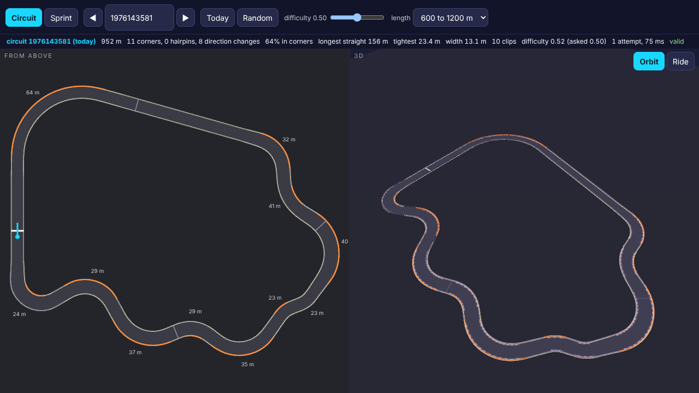
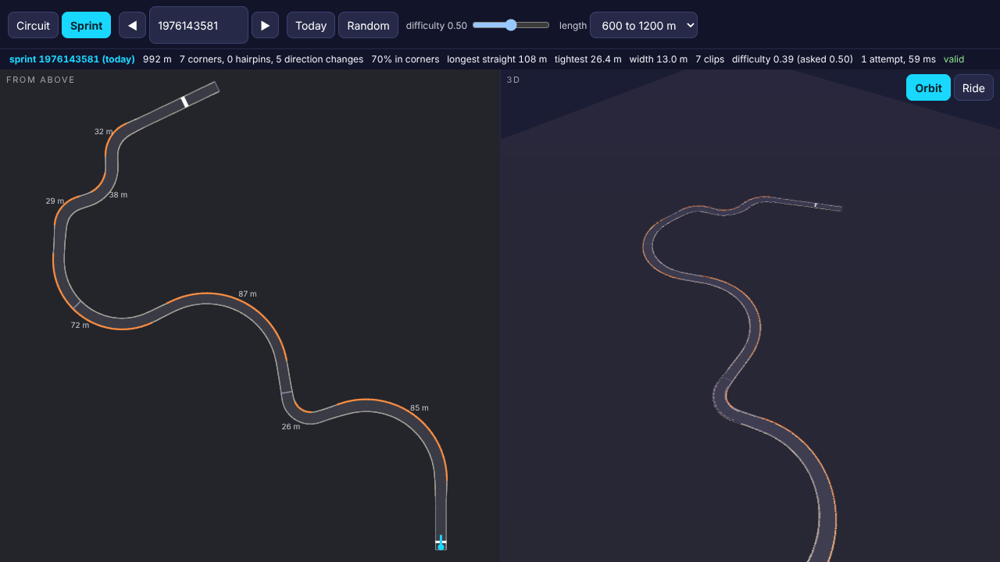
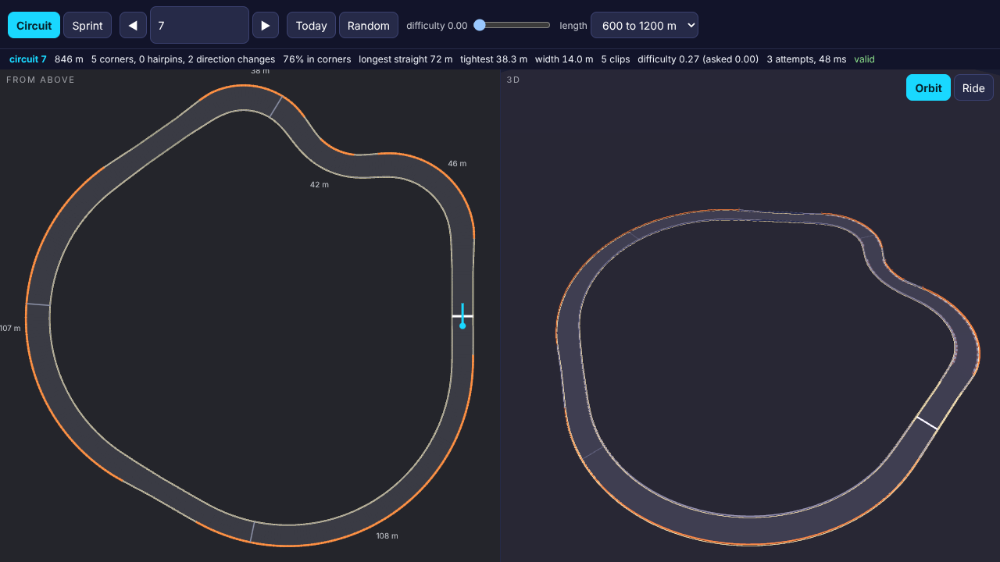
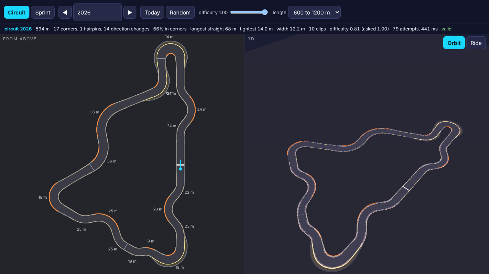
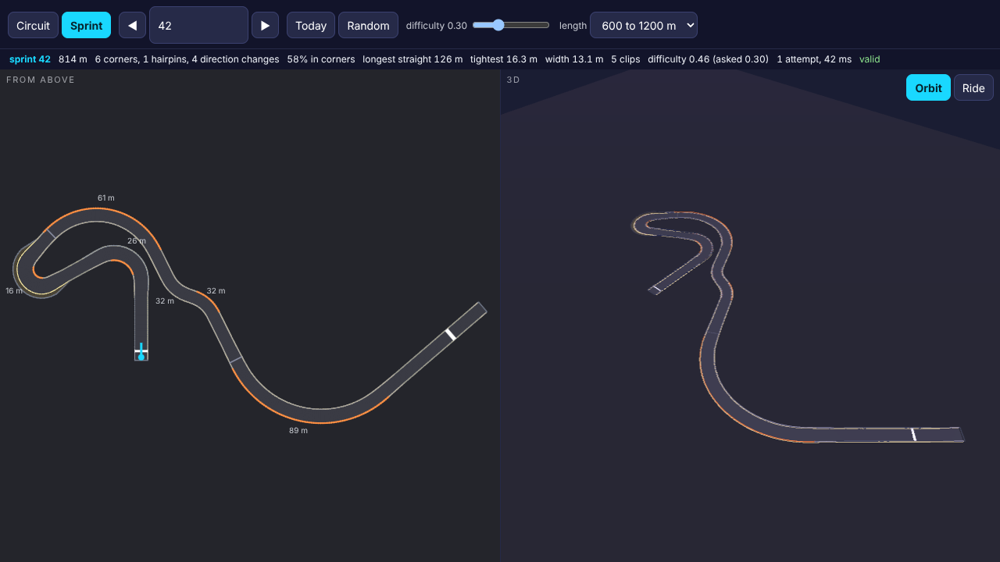
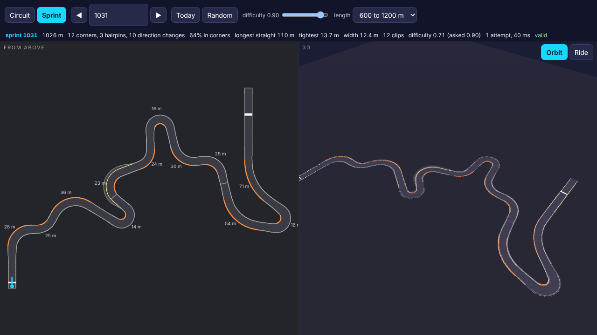

# The track generator: report

Branch `crazygames-tracks`, DESIGN.md build step 2, brief
`briefs/TRACKS.md`. Every number below was measured by
`game/test/tracks/probes.js` (Node, plus headless Chromium for the
cross engine check); the JSON beside this file is what it wrote and
`probes.log` is the full run's output.

## In short

- `generateTrack(seed, { kind, length, difficulty })` in
  `game/src/tracks/generate.js` gives a closed circuit or a point to
  point sprint as plain data, in exactly the shape of the hand made test
  track, and `physics/world.js` drives it unchanged: the scripted driver
  finished 200 of 200 generated tracks with no respawns and no wall
  contact, `clipDistance` reads the clip walls, and a sprint's end caps
  stop the car.
- Courses are built from straights, clothoid ramps and arcs, so every
  corner's radius is known: hairpins (12.5 to 22 m), tight corners,
  fast sweepers (40 to 110 m), esses of two or three linked corners
  that change direction, and chicanes. Widths 11 to 17 m, a little
  rise and fall and up to 3 degrees of bank, run-off before set back
  tyre walls on some corners, fences on long straights, and clipping
  zones on the inside of hairpins and the outside of sweepers.
  Difficulty tightens the corners, narrows the road and adds more
  direction changes.
- Valid over 1,000 seeds per kind: no crossing and no two barriers
  closer than 4 m, the full drivable width clear of every wall, the
  length inside the target, every corner radius inside 12 to 120 m, the
  width inside 10 to 18 m, crests that unload at most 0.43 g at the
  car's 223 km/h top speed. No seed needed the fallback course.
- Byte identical for a seed, in Node and in Chromium (400 of 400 tracks
  and the daily track). The generator calls no `Math.sin`, `Math.cos`
  or `Math.random`; `dmath.js` does its own trigonometry so the daily
  track is the same in every engine.
- `dailySeed(date)` is the same for the same local date in six time
  zones from UTC+14 to UTC-11, and differs every day for ten years.
- `buildTrackMesh(track, THREE)` in `mesh.js`: road, edges, kerbs,
  run-off, start, finish and checkpoint lines, barriers by kind with
  clip zones in orange, and posts at each zone's ends and apex. Two draw
  calls, 7,000 to 12,000 triangles.
- `game/lab/tracks.html`: the track from above and in 3D (orbit, or a
  ride along at driving height), with kind, seed, previous and next,
  today's track, random, difficulty and length, and a line of stats.
  Works on a phone in portrait (`shots/lab-portrait.png`).
- Every known answer was caught (24 of them, listed below).
- `npm run build` passes: the new game is 20 files, 1.14 MB initial
  download. Nothing outside `game/src/tracks/`, `game/test/tracks/`,
  `game/lab/` and `review/tracks/` was touched.

## Things the next session needs to know

1. **Elevation is in the data but the physics is flat.** `world.js`
   reads only x and z, and the game's `scene.js` draws the road at
   y = 0. `buildTrackMesh` draws the road at its real height, so a car
   drawn at y = 0 would sink into a crest or float over a dip (the rise
   and fall reaches 5.6 m in total). Until the car follows the road's
   height, generate with `{ elevation: 0 }`: y and bank are then exactly
   zero (measured on 40 tracks, known answer caught).
2. **Barrier kinds per span are not reported by the physics.**
   `world.js` gives a hit the kind of the whole polyline, and
   `walls[0]` and `walls[1]` must each be one polyline with a point per
   sample, because `clipDistance` and the scene index them by sample.
   So the kinds are in `wall.spans` (`{ from, to, kind, runoff }`) and
   a hit reports `'concrete'`. Reading the span at the hit's position
   is a one line change in `world.js`, which is not my folder.
3. **The game's `scene.js` draws every track as a closed loop.** Its
   `ribbon(..., true, ...)` would join a sprint's finish to its start.
   Use `buildTrackMesh` for the track, or pass `closed = kind ===
   'circuit'`.
4. A sprint has two more walls after the barriers, its end caps
   (`cap: 'start'` and `cap: 'finish'`, kind `'tyres'`). `finish.along`
   is 40 m before the end: there is run-out past the line.
5. `start.yaw` is where the car faces; `start.along` is 2 m and the
   start line is at 8 m, which is sample 4, where the game's scene
   already draws its line. `checkpoints` are three quarter points on a
   circuit and two thirds on a sprint.
6. Generation takes 26 ms at the median for a circuit and 11 ms for a
   sprint, but the worst of 1,000 was 351 ms for a circuit and 521 ms
   for a sprint (Node, this machine). Do it once per track, not per
   frame, and expect it to be slower on a Chromebook.

## The data contract

```
kind         'circuit' | 'sprint'
length       metres: a circuit's lap, a sprint's centre line end to end
centre[]     every 2 m: { x, y, z, heading, bank, width }. heading is the
             vehicle's yaw (zero faces -Z, positive turns left), width the
             full drivable width, bank radians (positive lowers the left
             edge). Sample i is at i * 2 m.
walls[]      [0] left and [1] right barriers, one point beside each sample
             (a circuit repeats the first at the end), each
             { side, kind, points, spans: [{ from, to, kind, runoff }] };
             a sprint adds two end caps { cap: 'start' | 'finish' }
clips[]      { from, to, side, kind: 'inner' | 'outer', apex, corner }
start        { along, x, y, z, yaw, heading }; startLine; checkpoints[];
             finish { along, x, y, z, heading, width } or null for a circuit
bounds       { minX, maxX, minZ, maxZ, minY, maxY }, padded 30 m
difficulty   0 to 1, an estimate from the geometry
corners[]    { name, type, from, to, apex, radius, angle, dir } as designed;
sections     { name: [from, to] } for the scripted driver; cones []
seed, name, version, target, requested, attempts, rejected, fallback
```

Run-off is a barrier set back by up to 4 m behind a gravel strip, not a
gap in the wall: `world.js` respawns a car 6 m past the edge, so a gap
would end a run where the brief wants a recovery, and a set back barrier
stays inside that line. Never inside a clipping zone, which must judge
the wall at the road's edge.

## Measurements

The full run, 1,000 seeds per kind with seed n at difficulty
((n - 1) mod 11) / 10, takes 289 s. `node game/test/tracks/probes.js`;
`--seeds 100` for a quicker run, `--only 1,2,3,W,D,M`, `--no-browser`.

### 1. Determinism

| | result |
|---|---|
| Same seed twice, 2,000 tracks | 0 mismatches |
| Different seeds | 1,000 distinct of 1,000 per kind |
| Node against Chromium, 400 tracks and the daily track | 0 differ |
| Engine dependent maths in generate, analyse, dmath | 0 calls |

Known answers: a generator that flips a seed bit at random is caught
(11 of 20 repeats differ); one that ignores the seed is caught (1
distinct of 20); the same source scan finds 18 calls in `world.js`;
the browser copy with its sine one part in a million high differs from
Node on 400 of 400 tracks.

Honest caveat: with plain `Math.sin` and `Math.cos` this Node and this
Chromium happen to agree on all 400 tracks too, and a sine one unit in
the last place high changes none of them, because the output is rounded
to 0.1 mm and a millionth of a radian. So the cross engine check cannot
show what `dmath.js` buys on these two engines; it is there because
other engines (Safari on a phone) are not guaranteed to agree, and the
daily track and ghosts have to.

### 2. Validity, 1,000 seeds per kind

| check | circuits | sprints |
|---|---|---|
| invalid tracks, fallbacks | 0, 0 | 0, 0 |
| no self-overlap: wall segments that cross | 0 | 0 |
| closest barrier not beside the same stretch of wall (at least 4 m) | 4.01 m | 4.02 m |
| drivable width clear of every wall: worst margin | -0.052 m | -0.055 m |
| length (600 to 1200 m) | 614 to 1200 m | 630 to 1198 m |
| corner radius (12 to 120 m) | 12.51 to 109.8 m | 12.54 to 109.9 m |
| width (10 to 18 m) | 11.03 to 16.93 m | 11.00 to 16.97 m |
| crest unloading at 223 km/h | 0.43 g | 0.40 g |
| attempts per track: median, p95, worst | 9, 43, 123 | 1, 5, 15 |

Targets of about 600, 900 and 1,200 m (100 seeds each, plus or minus
10 per cent) all valid, no fallbacks. The fallback courses, which no
seed needed, are valid at every target.

The clearance margin is negative by up to 5.5 cm on purpose: the wall
points sit at exactly half the width beside each sample, and on the
inside of a tight corner the straight chord between two of them cuts
in by that much. The check allows 0.1 m.

Known answers, each a hand broken track that must fail its check (all
caught): a sprint that turns 300 degrees and crosses itself (overlap);
two hairpins that bring the course back beside its start straight 2.75
m barrier to barrier without crossing (overlap); five wall points pulled
to 40 per cent of the half width (clearance); a target 2 m above the
length (length); a corner of radius 11 m and one of 160 m (radius); 9 m
of width (width); a 1.2 m bump over 16 m, an 8 per cent ramp and 8.6
degrees of bank (elevation); a wall shifted three samples (contract); a
sample removed (spacing). The base track they are made from is valid,
as a control.

### 3. Drift character, 1,000 seeds per kind

p50 [p5, p95], then the extremes:

| | circuits | sprints |
|---|---|---|
| share of the length in corners | 62% [51, 71], 40 to 77% | 61% [52, 68], 43 to 75% |
| direction changes | 6 [2, 12], 0 to 16 | 8 [3, 13], 1 to 18 |
| longest straight | 114 [72, 152], 60 to 164 m | 112 [90, 152], 80 to 166 m |
| corners | 10 [6, 16] | 10 [6, 17] |
| hairpins (130 degrees or more, 22 m or tighter) | 1 [0, 3], up to 5 | 1 [0, 3], up to 7 |
| clipping zones | 9 [6, 14] | 9 [5, 14] |
| tightest corner | 18.6 [13.3, 30.0] m | 17.7 [13.3, 29.8] m |
| mean width | 13.2 [12.3, 14.1] m | 13.1 [12.3, 14.0] m |

By requested difficulty (medians, circuits / sprints):

| difficulty | direction changes | tightest corner | mean width | hairpins | estimate |
|---|---|---|---|---|---|
| 0 | 4 / 5 | 25.6 / 25.0 m | 14.0 / 13.9 m | 0 / 0 | 0.38 / 0.40 |
| 0.5 | 6 / 8 | 17.8 / 17.8 m | 13.2 / 13.2 m | 1 / 1 | 0.55 / 0.57 |
| 1 | 10 / 11 | 14.1 / 14.0 m | 12.3 / 12.3 m | 1 / 2 | 0.73 / 0.74 |

The requested and estimated difficulty rank together at 0.82
(circuits) and 0.85 (sprints), Spearman. The hand made test track, for
comparison: 712 m, 65% in corners, 12 direction changes, longest
straight 98 m.

A corner here is a run of samples turning one way more tightly than
250 m. The longest straight includes the start straight, which is 50
to 80 m by design, joined to the last straight on a circuit. Some
circuits have no direction change at all (minimum 0): every corner
turns the same way, an oval with kinks. That is rare at low difficulty
and never at high.

Known answers: the analyser on a course built to known numbers (three
corners of 30, 30 and 20 m, two direction changes, a 100 m straight)
reads all four correctly; with its straight threshold set to 25 m it
reads 1 corner, 0 changes and a 296 m straight on the same course
(caught).

### W. In the physics world, unchanged

| | result |
|---|---|
| scripted driver, 100 circuits | 100 finished a lap, 0 respawns, 0 wall touches, 33 to 75 s |
| scripted driver, 100 sprints | 100 reached the finish, 0 respawns, 0 wall touches, 32 to 70 s |
| clipDistance, car parked 1.5 m from a clip wall | 0.525 m, expected 0.58 m |
| end caps, 30 sprints, flat out past the finish and reversing at the start | the car stops with its bumper at the cap's face both ways |

Known answers: a barrier moved into the road for 30 m gives 387 touches
and 193 respawns where there were none (caught); barriers misaligned by
ten samples make clipDistance read 6.25 m (caught); a sprint without its
caps lets the car 30 m past the end and 47 m behind the start (caught).

What this does not show: the scripted driver drives on grip at 7 m/s²,
not drifting. It proves the data works in `world.js`, not that every
corner is fun to drift. That is the author's judgement in the lab and,
once wired in, in the game.

### D. The daily seed

`dailySeed` hashes the local year, month and day. In Kiritimati
(UTC+14), Sydney, Kolkata, UTC, Los Angeles and Pago Pago (UTC-11), at
00:05 and 23:55 on 31 October 2026, it gives 1976143581 everywhere and
1113709271 the next day; 3,653 distinct seeds over ten years. Known
answer: the same hash of the UTC date gives 3 different seeds for that
one local date (caught).

### M. The meshes

20 generated tracks and the hand made test track build in Node with no
non finite vertex, 6,932 to 11,718 triangles in two draw calls; a track
with one NaN coordinate gives 18 (caught). `elevation: 0` gives y and
bank of exactly zero on 40 tracks; the default reaches 5.63 m (caught).
The six screenshots below were drawn in headless Chromium on the forced
WebGL 2 path with no page errors (`game/test/tracks/shots.js`).

## Screenshots

Each from above (left) and in 3D (right), landscape; `-ride` is the
same track from driving height.

- `shots/circuit-1976143581.png`: today's circuit, 952 m
- `shots/sprint-1976143581.png`: today's sprint, 992 m
- `shots/circuit-7.png`: difficulty 0, 846 m
- `shots/circuit-2026.png`: difficulty 1, 894 m, 17 corners, 14 direction changes
- `shots/sprint-42.png`: difficulty 0.3, 814 m
- `shots/sprint-1031.png`: difficulty 0.9, 1026 m, 3 hairpins
- `shots/lab-portrait.png`: the lab on a 390 by 844 phone








## Deviations from the brief and judgement calls, stated plainly

- **"No wall closer than the width"** is checked as: the full drivable
  width is clear of every wall at every sample (to 0.1 m, see above),
  and any two barriers that are not neighbours along one wall are at
  least 4 m apart. The other reading, that the barriers of two parts of
  the track that run side by side must be the road's width apart, is
  not enforced. Measured (`validity.json`, `partGap`): for parts at
  least 60 m apart along the track, 139 of 1,000 circuits and 142 of
  1,000 sprints have two barriers closer than the road is wide, the
  closest 4.05 m. That is a single wall between two roads, which is
  ordinary on a real circuit. If the author wants the stricter reading
  it is a constant change (`GAP` in `TRACKS`), at some cost in
  attempts. Known answer for the measurement: the 2.75 m case reads
  2.29 m, 0.19 of the width (caught).
- **Run-off is a set back barrier, not a gap** (see the data contract).
- **Barrier kinds live in `spans`, not one polyline per kind**, because
  `world.js` and the scene index the barriers by sample.
- **Corner radii are within 12 to 120 m, but no corner is wider than
  about 110 m.** The stated range is the generator's own (`TRACKS.RADIUS`);
  the brief gives no number. The hand made test track would fail it:
  its spline hairpins tighten to 10 m.
- **Lengths:** the default target is 600 to 1,200 m as the brief says. A
  single number, `length: 900`, means 900 plus or minus 10 per cent.
- **Rejection sampling.** A course that fails any check is redrawn from
  the same seeded stream, so the checks decide which course a seed
  gives. Changing a check or a constant changes the tracks for some
  seeds; once a daily track has been played, that is a version change
  (`version: 1` is in the output for that reason).
- **Elevation is generated but the physics ignores it** (point 1 above).

## Not done

- No ghosts and no daily mode in the game. DESIGN.md puts them in step
  2, but TRACKS.md does not ask for them, and the game loop session
  wires the generator in.
- No drift test on generated tracks: the scripted driver's drift mode
  needs a named section and was tuned on the test track. `sections`
  is in the output so it can be pointed at any corner.
- The lab's frame rate on a phone and the meshes' cost on the low tier
  are unmeasured. The sandbox has no GPU.
- Nobody has looked at these on a phone yet.

## Files

```
game/src/tracks/generate.js    generateTrack, dailySeed, TRACKS (every tunable), trackFromElements for the probes
game/src/tracks/analyse.js     validateTrack, characterOf, cornersOf, curvatureOf, difficultyOf
game/src/tracks/dmath.js       sine and cosine from + - * / only, the same in every engine
game/src/tracks/mesh.js        buildTrackMesh(track, THREE) and its LOOK block
game/lab/tracks.html           the lab, at /lab/tracks.html on the preview
game/test/tracks/probes.js     the measurements and known answers
game/test/tracks/shots.js      the screenshots
game/test/tracks/lib.js        shared helpers
review/tracks/                 this report, the JSON, probes.log, shots/
```
